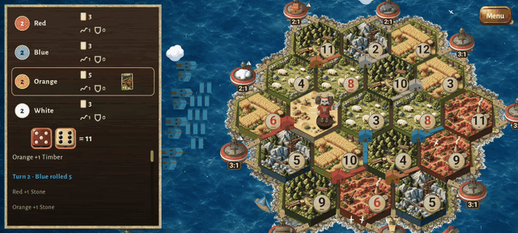
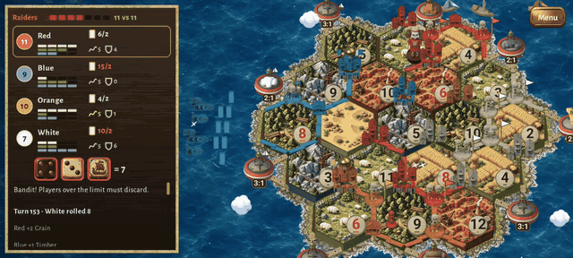

# Working German Board Game

Open-source Android hex-trading board game, compatible with the rules of the
classic German settlement-building game, for up to 4 players plus AI.
Not affiliated with or endorsed by Catan GmbH. See [Trademarks](#trademarks).



*Four built-in bots playing the base game at 1x, board tilted: rendered homesteads, towns and roads in each
player's colour, the bandit on a number plate, boats and gulls on the sea.*



*Age of Chivalry in the Pirate theme: knights, city walls, the event die and the Raiders' ship.*

**Play it:** [download the Android preview APK](https://github.com/cyclistmass/shareable/releases/latest/download/working-german-board-game.apk)
· [1-minute gameplay video](https://github.com/cyclistmass/shareable/releases/latest/download/working-german-board-game-gameplay.mp4)
· [all releases](https://github.com/cyclistmass/shareable/releases)

### Screenshots

| | |
|---|---|
|  |  |
| Tilt and zoom the table (two fingers, or the Zoom/Tilt bars) | Age of Chivalry, Pirate theme: walls, Capitals, knights |
|  |  |
| Your unplayed pieces wait on the water in front of you | Trading: tap the top of a card to ask, the bottom to offer |
|  |  |
| The Inventory: every tile, piece, card and die | Settings: scenery, theme, event die style |

License: GPL-3.0 (see `LICENSE`).

## Modules

| Module | Purpose |
|---|---|
| `engine/` | Pure Kotlin, deterministic rules engine (base game and the Age of Chivalry expansion). Runs on PC. |
| `ai/` | Pure Kotlin bots: Catanatron-style value function + AlphaBeta, later ONNX-guided search. |
| `app/` | Android UI (Jetpack Compose). |
| `trainer/` *(planned)* | PC-side Python training on a Catanatron fork, exports ONNX. |
| `net/` | Pure Kotlin transport API, local fake and deterministic online replay; Firebase adapter in `app/`. |

## Build

Requires JDK 17 and the Android SDK (`local.properties` with `sdk.dir`, not committed).

```
./gradlew :engine:test          # rules tests on PC
./gradlew :app:installDebug     # install on running emulator/device
```

Secrets (`google-services.json`, keystores, `.env`) are gitignored and must never be committed.

Online play data model, AppRoot wiring, test plan and rules deployment: [docs/online-play.md](docs/online-play.md).

Every test and test script, what CI runs, and the known gaps: [docs/testing/README.md](docs/testing/README.md).

## Trademarks

Working German Board Game is an original, independent game. It is not affiliated with, endorsed by or sponsored by
Catan GmbH, Catan Studio or any of their licensees. CATAN and Cities & Knights are trademarks of Catan GmbH. We name
them here, and Catanatron (the open-source bot project we cross-check our rules against), only to say that we are not
them.

Game rules and mechanics are not protected by copyright, so this game can play by compatible rules, but everything you
see and read is our own: the name, every resource, piece and card name (see the expansion, Age of Chivalry), the rules
text and all the art, which is either made for this game or CC0 (sources in [CREDITS.md](CREDITS.md)).
